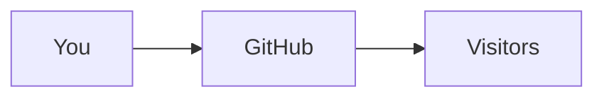

# hello-github


A tiny app to learn GitHub, one commit at a time.

## Usage

```python
def hello(name):
    return f"Hello, {name}!"
```

## Features

| Feature | Status |
|---|---|
| Hello endpoint | Done |
| Health check | Planned |

## Roadmap

- [x] Create the repository
- [ ] Add a CI workflow

> [!TIP]
> New here? Start with the [GitHub Docs](https://docs.github.com).

## How it works


